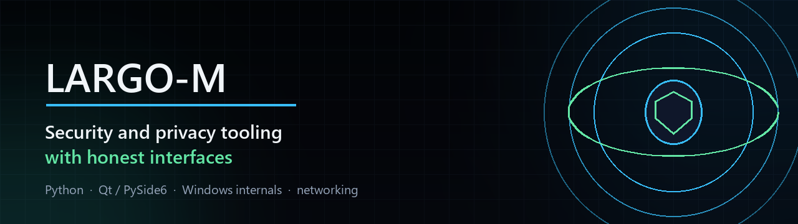

🛡️ Largo-m — Security & Privacy Tooling with Honest Interfaces
<div align="center">
Security and privacy tooling that is honest about what it does
Python · Qt / PySide6 · Windows internals · networking · developer tooling · threat modeling · reproducible builds · CI/CD · local-first design · authorised testing


<a href="https://github.com/Largo-m?tab=followers">  </a> <a href="https://github.com/Largo-m?tab=repositories">  </a> <a href="https://github.com/sponsors/Largo-m">  </a> <a href="https://github.com/Largo-m?tab=achievements">  </a>


<a href="#-about-me">  </a> <a href="#-what-i-am-building--projects">  </a> <a href="#-how-i-build--engineering-principles">  </a> <a href="#-by-the-numbers">  </a> <a href="#-toolbox">  </a> <a href="#-reach-me">  </a></div>
📖 About Me
I am Largo-m — a developer working at the intersection of security, privacy, and honest user experience. I build tools that do not lie to their users.

The security industry has a dirty secret: many tools are designed to look secure rather than be secure. A green padlock appears, a "Connected" label lights up, a progress bar fills — and the user walks away believing they are protected when, in reality, nothing has changed about their exposure. I consider this a form of malpractice. A security tool that manufactures a false sense of safety is worse than no tool at all, because it removes the user's incentive to seek real protection.

My work is a long, deliberate argument against that pattern. Every project I ship follows the same contract with its users:

If a feature does not exist, the README says so, and the UI says so.

That single sentence sounds simple. In practice it requires 122 tests in one project and 214 in another just to make sure the UI never drifts from reality. It requires demo modes that are loudly labelled as demo modes. It requires refusing to ship a "Connected" state until a real handshake has actually completed. It requires documentation that is honest about limitations, not just enthusiastic about features.

I work primarily in Python and Qt / PySide6, with deep interest in Windows internals, networking, proxy protocols, malware behaviour simulation, and developer tooling. My projects range from desktop clients for Xray VLESS to pure-standard-library parsers for share links, from safe ransomware behaviour simulators to authorised phishing simulation platforms. What ties them together is not a technology stack — it is a philosophy of honesty.

I believe that privacy is a default, not a feature. I believe that reproducible builds are a security property, not a convenience. I believe that tests are documentation and that documentation is a feature. And I believe that authorised testing is the only kind of security testing that should exist — which is why every simulation tool I build includes guard rails that refuse to run outside an explicit, logged authorisation scope.

If you are here because you want tools that tell you the truth — welcome. If you are here because you want tools that feel secure without the work — this is not the place for you, and that is the point.

⚡ What I Am Building — Projects
🚀 ExploitFA — A PySide6 desktop client for Xray VLESS
<div align="center"><a href="https://github.com/Largo-m/ExploitFA">  </a>


<a href="https://github.com/Largo-m/ExploitFA/stargazers">  </a> <a href="https://github.com/Largo-m/ExploitFA/releases/latest">  </a> <a href="https://github.com/Largo-m/ExploitFA/actions/workflows/ci.yml">  </a> <a href="https://github.com/Largo-m/ExploitFA/blob/main/LICENSE">  </a> <a href="https://github.com/Largo-m/ExploitFA/commits/main">  </a></div>
An English-first, left-to-right PySide6 desktop client for Xray VLESS on Windows. This is not a wrapper around a CLI — it is a real Qt interface with strict JSON configuration, checksum-verified builds, live core supervision, and a demo mode that never pretends your traffic is protected.

ExploitFA was born from frustration. Most VLESS clients on Windows are either (a) thin wrappers around a command-line core with a UI bolted on top, or (b) polished-looking apps that show a green "Connected" badge without ever verifying that a handshake completed. ExploitFA tries to be neither. It is a native Qt application with a proper state machine, a real configuration schema, and a UI that is contractually forbidden from claiming protection it cannot demonstrate.

Supported transports and security layers:

Layer	Options
Security	Reality · TLS
Transport	TCP · WebSocket · gRPC
Core	Live Xray core with process supervision
Local proxy	SOCKS5 + HTTP
Configuration	Strict JSON schema, validated before launch
Platform	Windows (primary), with Linux support on the roadmap
Key engineering decisions:

✅ 122 tests covering validation, parsing, process supervision, and UI state machines — all run headless in CI

✅ Checksum-verified core binaries — every release ships with SHA256SUMS.txt

✅ Reproducible builds — releases are built by a workflow from a git tag, never from a developer's machine

✅ Demo mode — a first-class feature that explicitly tells the user "no traffic is being protected" so nobody mistakes a screenshot for a guarantee

✅ No telemetry endpoints — zero phone-home behaviour, verifiable in the source

✅ Process supervision — the core is monitored, restarted on failure, and its exit codes are surfaced to the user

✅ Strict configuration validation — malformed JSON is rejected before the core ever launches

Why it matters: ExploitFA is a case study in what it looks like to build a proxy client that refuses to lie. The demo mode alone is worth studying: it is a UI state whose entire purpose is to prevent the user from believing something untrue. Most applications would never ship such a state. ExploitFA ships it first.

🧰 vless-toolkit — Parse, validate, build, convert, sort and redact share links
<div align="center"><a href="https://github.com/Largo-m/vless-toolkit/stargazers">  </a> <a href="https://github.com/Largo-m/vless-toolkit/releases/latest">  </a> <a href="https://github.com/Largo-m/vless-toolkit/actions/workflows/ci.yml">  </a> <a href="https://github.com/Largo-m/vless-toolkit/blob/main/LICENSE">  </a></div>
A pure standard library toolkit that parses, validates, builds, converts, sorts, and redacts VLESS / VMess / Trojan / Shadowsocks share links and base64 subscriptions. No network code. No third-party dependencies. Safe to drop into any CI pipeline without supply-chain anxiety.

console
$ vless-toolkit summary links.txt
total: 4  unique hosts: 4
by protocol:
  vless: 1  vmess: 1
  trojan: 1  shadowsocks: 1
by country:
  DE: 1  NL: 1  JP: 1  SG: 1
What it does:

🔍 Parse share links and base64-encoded subscription blobs

✅ Validate scheme, credentials, transport parameters, and port ranges

🏗️ Build canonical share links from structured data

🔄 Convert between protocols and between link / subscription formats

📊 Sort entries by protocol, country, latency hint, or custom keys

🕵️ Redact sensitive fields for safe sharing in issues and screenshots

🧪 214 tests — headless, hermetic, and run on every PR

📦 Zero dependencies — pure standard library, auditable in an afternoon

Why it matters: vless-toolkit is the tool I reach for whenever I need to reason about a subscription file without trusting a third-party parser. Because it has zero dependencies and no network code, it can be reviewed line by line, embedded in CI, and used to redact sensitive credentials before they ever reach a bug report. The redact command alone has saved me from accidentally pasting a live UUID into a GitHub issue more than once.

🛡️ SecuSploitX — All-in-one AI-powered security toolkit
<div align="center"><a href="https://github.com/Largo-m/SecuSploitX/stargazers">  </a> <a href="https://github.com/Largo-m/SecuSploitX/releases/latest">  </a> <a href="https://github.com/Largo-m/SecuSploitX/blob/main/LICENSE">  </a></div>
An all-in-one, AI-assisted security toolkit covering web, network, and phishing testing with a modular CLI and GUI. Designed for authorised assessments only, with clear scope prompts and audit logging.

🌐 Web testing — endpoint discovery, header analysis, misconfiguration checks

📡 Network testing — port and service enumeration with safe defaults

🎣 Phishing simulation — authorised campaigns with consent tracking

🧩 Modular architecture — every module is independently loadable and testable

🖥️ Dual interface — CLI for automation, GUI for guided assessments

📝 Audit logging — every action is tied to an authorised scope record

Why it matters: SecuSploitX is my attempt to build a security toolkit that is usable without being irresponsible. The modular design means you can load only the modules you need, the dual interface means you can script it or click through it, and the audit logging means every action has a paper trail. It is not a toy and it is not a weapon — it is a professional tool with a conscience.

👻 GhostTrace — Multi-hop proxy chains
Chain multiple proxies into a single controlled route with explicit hop accounting, failure isolation, and honest reporting of what each hop actually guarantees. Built for researchers who need reproducible routing, not magic.

🔗 Multi-hop chaining — SOCKS5 / HTTP proxies with per-hop validation

🧾 Hop accounting — every hop is logged, timed, and health-checked

🛑 Failure isolation — a dead hop never silently degrades to direct connection

📊 Reproducible routes — exportable chain definitions for repeatable tests

🔍 Honest reporting — the tool tells you what each hop does and does not protect against

Why it matters: Most proxy-chain tools have a catastrophic failure mode: when a hop dies, they fall back to a direct connection without telling you. GhostTrace treats that as a bug, not a feature. If a hop fails, the chain fails loudly. That is the only honest behaviour for a tool whose entire purpose is routing.

🎣 cyphisher — Authorised phishing simulation
A phishing simulation platform built for authorised red-team exercises and security-awareness programs. Consent-first design: no target is contacted without an explicit, logged authorisation record.

📝 Authorisation records — every campaign is tied to a signed scope

📬 Template engine — realistic, localisable simulation emails

📈 Awareness metrics — report click rates without collecting unnecessary PII

🔒 Local-first — campaign data stays on your infrastructure

🛑 Guard rails — the tool refuses to launch a campaign without an authorisation record

Why it matters: Phishing simulation is one of the most abused categories of security tooling. cyphisher is built on the premise that the tool itself should enforce authorisation, not rely on the operator's good intentions. The authorisation record is not a checkbox — it is a hard gate.

🧪 Ransomware-Analyzer — Safe behaviour simulation
A safe behaviour simulator for understanding ransomware-like file operations without ever encrypting real user data. Everything runs inside a sandboxed, disposable workspace with explicit guard rails.

🧱 Sandboxed workspace — no writes outside the designated directory

📋 Behaviour traces — file operations, renames, and deletions are logged

🛡️ Hard guard rails — the simulator refuses to run outside a disposable root

📚 Educational output — traces are explained, not just dumped

🔬 Reproducible experiments — every run produces an artifact you can compare

Why it matters: Understanding ransomware behaviour is essential to defending against it, but running real ransomware is obviously unacceptable. Ransomware-Analyzer occupies the narrow, useful space in between: it simulates the behaviour safely, so researchers can study patterns without risking a single real file.

🎬 AutoCaption — Local-first subtitles
A local-first subtitle generator: your media never leaves your machine. Built for people who want captions without uploading personal videos to a third-party service.

🏠 Local-first — no uploads, no cloud dependency

🎞️ Batch processing — queue multiple files with consistent settings

🌍 Multi-language output — configurable target languages

🔇 Offline capable — runs without a network connection once models are present

🔐 Privacy by architecture — there is no server to leak your media to

Why it matters: AutoCaption is the project that most clearly demonstrates the privacy-by-architecture principle. It is not that the tool promises not to upload your videos — it is that there is no upload code path at all. Privacy you can verify is worth more than privacy you have to trust.

🧭 How I Build — Engineering Principles
<table> <tr> <td width="50%" valign="top">
🎯 Honest interfaces
If a feature does not exist, the README says so and the UI says so. No fake "connected" states, no implied protection. Demo modes are labelled as demo modes. A green badge means a verified handshake, not a hopeful animation.

</td> <td width="50%" valign="top">
🧪 Tests before features
Validation, parsing, and process supervision are pure functions with real coverage — 122 tests in ExploitFA, 214 in vless-toolkit, all headless in CI. A feature without a test is a rumour.

</td> </tr> <tr> <td width="50%" valign="top">
📦 Small, boring dependencies
Standard library first. Every unavoidable dependency is pinned, licensed, and explained in the README. No dependency is added "just in case". A dependency you cannot explain is a dependency you cannot trust.

</td> <td width="50%" valign="top">
🔁 Reproducible builds
Checksums for core binaries, SHA256SUMS.txt next to every artifact, releases built by a workflow from a tag — never from a developer's laptop. If you cannot rebuild it, you cannot verify it.

</td> </tr> <tr> <td width="50%" valign="top">
📚 Documentation as a feature
Long READMEs with real screenshots and real command output, architecture notes that explain trade-offs, and tests that fail when a documentation link breaks. Docs are not an afterthought; they are part of the product.

</td> <td width="50%" valign="top">
🔒 Privacy by default
Zero telemetry endpoints. No analytics SDKs. No "anonymous usage statistics". If a project needs data, it asks first and stores it locally. The absence of a server is the strongest privacy policy.

</td> </tr> <tr> <td width="50%" valign="top">
⚖️ Authorised use only
Security tooling is for authorised testing only. Every repository states this clearly, and simulation tools include guard rails that refuse to run outside an authorised scope. The tool enforces the policy, not the operator.

</td> <td width="50%" valign="top">
🧱 Fail loudly, never silently
A dead proxy hop, a failed handshake, a malformed config — every failure is surfaced, never smoothed over. Silent degradation is the enemy of honest tooling.

</td> </tr> </table>
📈 By the Numbers
<div align="center"><table> <tr> <td align="center"><b>122</b><br><sub>tests · ExploitFA</sub></td> <td align="center"><b>214</b><br><sub>tests · vless-toolkit</sub></td> <td align="center"><b>34</b><br><sub>merged pull requests</sub></td> <td align="center"><b>3</b><br><sub>CI jobs · every PR</sub></td> <td align="center"><b>0</b><br><sub>telemetry endpoints</sub></td> <td align="center"><b>7</b><br><sub>public repositories</sub></td> </tr> <tr> <td align="center"><b>100%</b><br><sub>standard-library-first</sub></td> <td align="center"><b>SHA256</b><br><sub>checksums on every artifact</sub></td> <td align="center"><b>Tag-built</b><br><sub>releases, not laptop builds</sub></td> <td align="center"><b>Headless</b><br><sub>CI test runs</sub></td> <td align="center"><b>Local-first</b><br><sub>data architecture</sub></td> <td align="center"><b>Authorised</b><br><sub>testing only</sub></td> </tr> </table></div>
🧰 Toolbox — Languages, Frameworks & Tools
<div align="center"><p>                     </p></div>
🏆 Achievements
<div align="center"><p> <a href="https://github.com/Largo-m?tab=achievements">  </a> <a href="https://github.com/Largo-m?tab=achievements">  </a> <a href="https://github.com/Largo-m?tab=achievements">  </a> <a href="https://github.com/Largo-m?tab=achievements">  </a> <a href="https://github.com/Largo-m?tab=achievements">  </a> </p>
<sub>Next up: <b>Pull Shark</b> (merged pull requests) and <b>Pair Extraordinaire</b> (co-authored commits).</sub>

</div>
🗺️ Roadmap — What Comes Next
<div align="center"><table> <tr> <td width="33%" valign="top" align="center">
🎯 Short Term
Complete ExploitFA UI tests

Add automatic light/dark mode

Document the Xray core architecture

Publish vless-toolkit as an installable package

Add more protocol support

</td> <td width="33%" valign="top" align="center">
🚀 Mid Term
Build a proxy-chain health dashboard in GhostTrace

Add signed reports to SecuSploitX

Expand Ransomware-Analyzer trace explanations

Add multi-language UI to ExploitFA

Improve AutoCaption batch performance

</td> <td width="33%" valign="top" align="center">
🌌 Long Term
Unify the toolset into a modular toolbox

Reproducible, signed reports across all projects

Full documentation site with searchable architecture notes

Community-contributed protocol modules

A shared design system for honest interfaces

</td> </tr> </table></div>
📫 Reach Me
<div align="center"><table> <tr> <td align="center" width="25%">
💬 GitHub
@Largo-m

</td> <td align="center" width="25%">
🛠️ Work with me
Open an issue or a discussion on any project

</td> <td align="center" width="25%">
💖 Support
GitHub Sponsors · a ⭐ on a repository you use is just as welcome

</td> <td align="center" width="25%">
🔎 Explore
All repositories · Achievements

</td> </tr> </table></div>
⚠️ Responsible Use
<div align="center">
Security tooling is for authorised testing only.

Use it on systems you own or have explicit written permission to assess.

Simulation tools include guard rails that refuse to run outside an authorised scope.

If you are unsure whether you have permission — you do not have permission.

</div>
<div align="center">
<sub>Built with care, tested in CI, and documented honestly. — Largo-m</sub>


<a href="https://github.com/Largo-m">  </a> <a href="https://github.com/sponsors/Largo-m">  </a> <a href="https://github.com/Largo-m?tab=repositories">  </a> <a href="https://github.com/Largo-m?tab=achievements">  </a></div> ```
