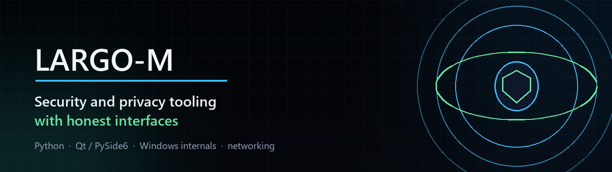

<div align="center">
  
</div>

<h3 align="center">Security and privacy tooling that is honest about what it does</h3>

<p align="center">
  <b>Python</b> · <b>Qt / PySide6</b> · <b>Windows internals</b> · <b>networking</b> · <b>developer tooling</b>
</p>

<p align="center">
  <a href="https://github.com/Largo-m?tab=followers"></a>
  <a href="https://github.com/Largo-m?tab=repositories"></a>
  <a href="https://github.com/sponsors/Largo-m"></a>
</p>

---

## ⚡ What I am building

<table>
<tr>
<td width="55%" valign="top">

### [ExploitFA](https://github.com/Largo-m/ExploitFA)

An English-first, left-to-right **PySide6** desktop client for Xray **VLESS** on
Windows. A real Qt interface, strict JSON configuration, checksum-verified
builds, and a demo mode that never pretends your traffic is protected.

`Reality` · `TLS` · `TCP` · `WebSocket` · `gRPC` · live core · SOCKS5 + HTTP

<a href="https://github.com/Largo-m/ExploitFA/stargazers"></a>
<a href="https://github.com/Largo-m/ExploitFA/releases/latest"></a>
<a href="https://github.com/Largo-m/ExploitFA/actions/workflows/ci.yml"></a>

</td>
<td width="45%" valign="top">

<a href="https://github.com/Largo-m/ExploitFA"></a>

</td>
</tr>
</table>

<table>
<tr>
<td width="50%" valign="top">

### [vless-toolkit](https://github.com/Largo-m/vless-toolkit)

Parse, validate, build, convert, **sort** and **redact** VLESS / VMess / Trojan /
Shadowsocks share links and base64 subscriptions. Pure standard library, no
network code, safe to drop into CI.

```console
$ vless-toolkit summary links.txt
total: 4  unique hosts: 4
by protocol:
  vless: 1  vmess: 1
  trojan: 1  shadowsocks: 1
by country:
  DE: 1  NL: 1  JP: 1  SG: 1
```

<a href="https://github.com/Largo-m/vless-toolkit/stargazers"></a>
<a href="https://github.com/Largo-m/vless-toolkit/releases/latest"></a>

</td>
<td width="50%" valign="top">

### [SecuSploitX](https://github.com/Largo-m/SecuSploitX)

All-in-one AI-powered security toolkit: web, network and phishing tests with a
modular CLI and GUI.

<a href="https://github.com/Largo-m/SecuSploitX/stargazers"></a>

### Also on GitHub

[GhostTrace](https://github.com/Largo-m/GhostTrace) — multi-hop proxy chains ·
[cyphisher](https://github.com/Largo-m/cyphisher) — authorised phishing simulation ·
[Ransomware-Analyzer](https://github.com/Largo-m/Ransomware-Analyzer) — safe behaviour simulation ·
[AutoCaption](https://github.com/Largo-m/AutoCaption) — local-first subtitles

</td>
</tr>
</table>

---

## 🧭 How I build

| Principle | What it means in practice |
| :-- | :-- |
| **Honest interfaces** | If a feature does not exist, the README says so and the UI says so. No fake "connected" states, no implied protection. |
| **Tests before features** | Validation, parsing and process supervision are pure functions with real coverage — 122 tests in ExploitFA, 214 in vless-toolkit, headless in CI. |
| **Small, boring dependencies** | Standard library first. Every unavoidable dependency is pinned, licensed and explained. |
| **Reproducible builds** | Checksums for core binaries, `SHA256SUMS.txt` next to every artifact, releases built by a workflow from a tag. |
| **Documentation as a feature** | Long READMEs with real screenshots and real command output, architecture notes that explain trade-offs, and tests that fail when a link breaks. |

---

## 📈 By the numbers

<table>
<tr>
<td align="center"><b>122</b><br><sub>tests · ExploitFA</sub></td>
<td align="center"><b>214</b><br><sub>tests · vless-toolkit</sub></td>
<td align="center"><b>34</b><br><sub>merged pull requests</sub></td>
<td align="center"><b>3</b><br><sub>CI jobs · every PR</sub></td>
<td align="center"><b>0</b><br><sub>telemetry endpoints</sub></td>
</tr>
</table>

---

## 🧰 Toolbox

<p>
  
  
  
  
  
  
  
  
  
  
  
</p>

---

## 🏆 Achievements

<p>
  <a href="https://github.com/Largo-m?tab=achievements"></a>
  <a href="https://github.com/Largo-m?tab=achievements"></a>
  <a href="https://github.com/Largo-m?tab=achievements"></a>
</p>

<sub>Next up: Pull Shark (merged pull requests) and Pair Extraordinaire (co-authored commits).</sub>

---

## 📫 Reach me

- **GitHub:** [@Largo-m](https://github.com/Largo-m)
- **Work with me:** open an issue or a [discussion](https://github.com/Largo-m/ExploitFA/discussions) on any project
- **Support:** [GitHub Sponsors](https://github.com/sponsors/Largo-m) · a ⭐ on a repository you use is just as welcome

<div align="center">
  <sub>Security tooling is for <b>authorised</b> testing only. Use it on systems you own or have explicit written permission to assess.</sub>
</div>
